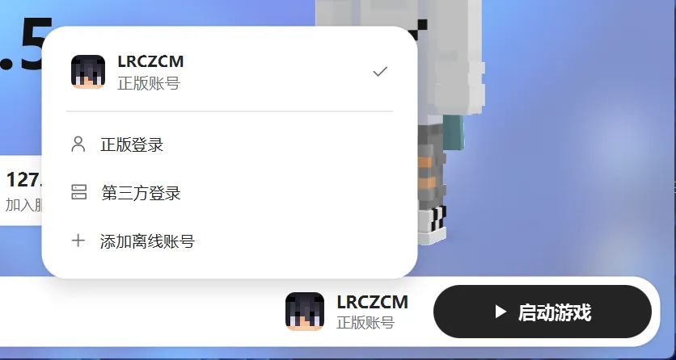

# 账号

点底部导航栏右边的账号按钮，可以添加、切换和管理账号。可以同时添加多个账号，启动时用当前选中的那个。

## 正版登录

适合买了 Minecraft Java 版的玩家。

1. 选“正版登录”。
2. 点“复制代码并打开浏览器”。
3. 在打开的微软网页上粘贴代码，登录你的微软账号。
4. 回到启动器，会自动完成登录。

登录失败时，按提示处理：

- **“尚未创建 Xbox 档案”**：先去 xbox.com 登录一次。
- **“未购买 Minecraft Java 版”**：这个账号没买游戏，或者还没在官网创建玩家档案。
- **“未成年账号”**：需要家长把账号加入 Microsoft 家庭组。

登录过期后，账号菜单里会提示“需要重新登录”，点“重新登录”就行。

## 离线账号

不用登录，起个名字就能玩。适合单人游戏和不验证正版的服务器。

- 玩家名称：3–16 位英文字母、数字或下划线。
- 高级选项里可以自己填 UUID（玩家的身份编号）。一般留空就行，系统会按名字自动生成。
- 改名时 UUID 不变，所以改名后存档里的物品和进度都还在。

## 第三方登录（皮肤站）

适合用 LittleSkin 等皮肤站账号的玩家。

1. 选“第三方登录”，选 LittleSkin，或者在“其他皮肤站”里填皮肤站地址。
2. 输入皮肤站的邮箱（或用户名）和密码，点“登录”。
3. 账号下有多个角色时，选一个要用的。

第三方账号的皮肤要去皮肤站网页上换，账号菜单里有“打开皮肤站”。

## 账号安全

- 正版登录的凭据会用 Windows 自带的加密保护起来，只有你当前的 Windows 用户能读取。
- 启动器不会把你的账号信息上传到任何地方。
- 账号文件损坏时，启动器会自动备份原文件并提示你重新添加账号。
