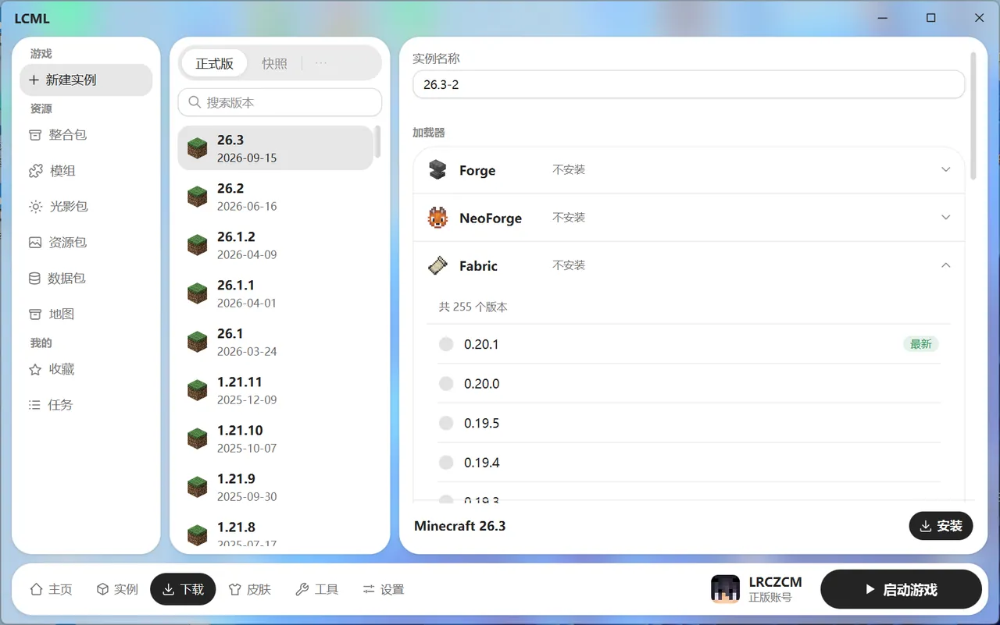

# 新建实例与下载任务

## 新建实例

在“下载 → 游戏 → 新建实例”：

1. **选游戏版本**：中间是版本列表，可以筛选“正式版”“快照”“远古版本”，也能搜索版本号。
2. **选加载器**：每个加载器默认是“不安装”，不装模组就不用动。要装模组，点开一个加载器，选一个版本，标“最新”的就是最新版。
3. **起个名字**（默认已经填好），点右下角的“安装”。

安装进度可以在“下载 → 任务”里看。装完后，这个实例就会出现在主页和实例页。

### 怎么选加载器

先看你要玩的模组或整合包要求哪个加载器，模组的介绍页上一般都会写。

| 加载器 | 说明 |
| --- | --- |
| Fabric | 轻量、更新快，新版本模组多 |
| Quilt | 和 Fabric 类似，大部分 Fabric 模组也能用 |
| Forge | 老牌加载器，支持很老的版本 |
| NeoForge | 从 Forge 分出来的，1.20.1 以后的新模组多用它 |
| Legacy Fabric | 让 1.13 以前的老版本也能用 Fabric |
| OptiFine | 提高帧数、支持光影；可以单独装，也能和 Forge 或 Fabric 一起装 |

- 选 Fabric 或 Quilt 时，默认会顺带装上 Fabric API（或 QFAPI）。大多数模组都需要它，不需要的话可以取消勾选。
- 勾选“显示测试版”可以看到加载器的测试版本。
- 手里有 Forge、NeoForge 或 OptiFine 的安装包，可以选“使用本地安装器”直接装。

## 下载任务

“下载 → 任务”里能看到所有下载：新建实例、启动前补文件、下载 Java、装模组、更新整合包等等。

- 每个任务都可以**暂停**、**继续**和**取消**。
- 暂停时已经下完的部分会保留。
- 关掉启动器后，没下完的任务下次打开还能接着下。
- 取消新建实例时，会删除没装完的实例；已经下完、其他实例也在用的游戏文件会保留。

下载慢或者老是失败，可以在“设置 → 下载”里换下载源或调整连接数，见 [设置 · 下载](settings.md#下载)。
