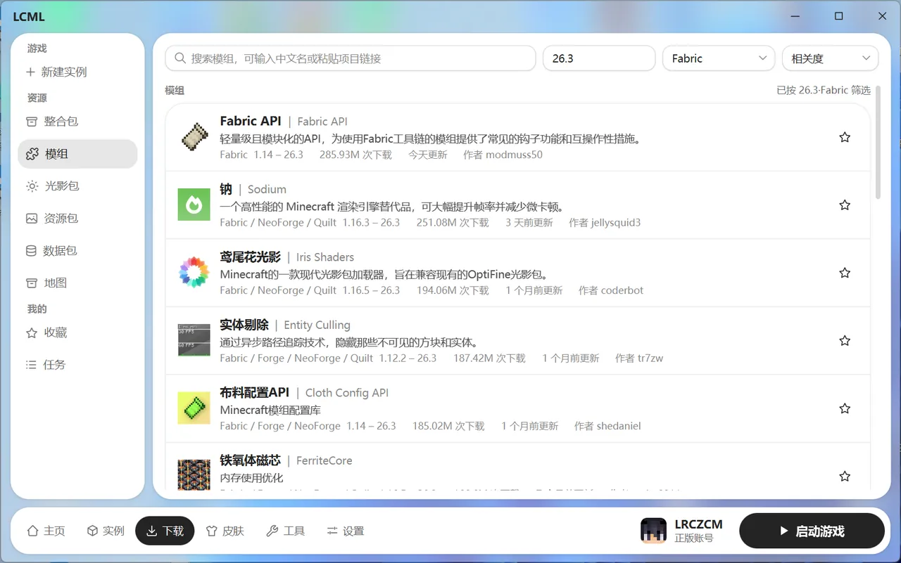
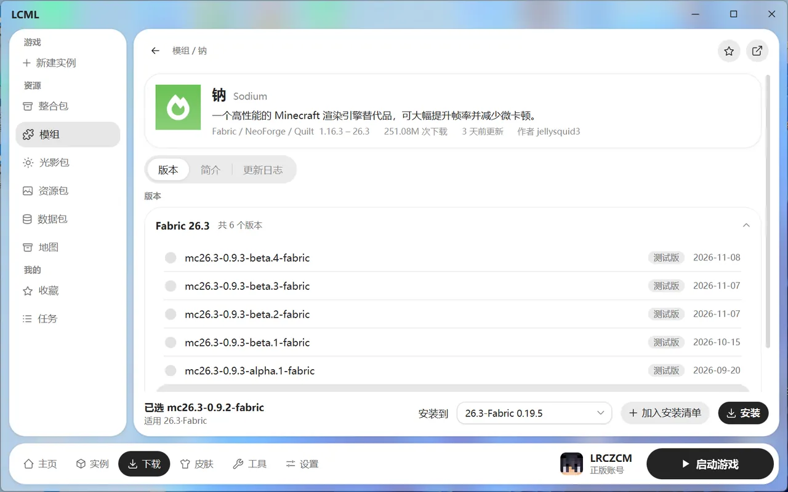

# 下载模组和其他资源

在“下载 → 资源”里，可以从 Modrinth 和 CurseForge 两个网站搜索、安装各种资源：

- 整合包
- 模组
- 光影包
- 资源包
- 数据包
- 地图（只有 CurseForge 有）

用哪个网站，在“设置 → 下载 → 资源平台”里选。

## 搜索

- 在搜索框输入名字。模组可以直接搜中文名，比如“机械动力”，常见模组都能搜到；搜不到时换成英文名再试。
- 搜索框右边可以选游戏版本和加载器，默认按当前选中的实例来筛选。结果可以按相关度、下载量或最近更新排序。
- 在网上看到某个资源，可以直接把它的 Modrinth 或 CurseForge 网址粘贴到搜索框，直接打开。
- 点右边的星星可以直接收藏。

## 看详情

点一个资源进入详情页，有三个标签：

- **版本**：所有可下载的版本，以及每个版本支持的游戏版本和加载器。
- **简介**：作者写的介绍。
- **更新日志**：每个版本改了什么。

“依赖”里列出了这个资源需要的其他模组（叫“前置”）。安装时，缺少的必需前置会一起装上。

## 安装

1. 在详情页选一个版本。启动器已经按实例帮你选好了合适的版本，一般不用改。
2. 在底部的“安装到”里选一个实例。只会列出游戏版本和加载器都对得上的实例。
3. 点“安装”。安装前会列出这次要做的事，确认后再开始：
   - 要装哪些文件、要替换哪些旧版本。
   - 有哪些可选前置，可以勾选一起装。
   - 有没有不兼容的模组。

不同类型的资源：

- **光影包**：实例里需要装有 Iris 或 OptiFine 才能用。
- **数据包**：要装进某个存档，所以实例里要先有存档。先进游戏创建一个世界再来装。
- **地图**：装好后会出现在实例的存档列表里。
- **整合包**：点“下载并导入”，会新建一个实例，详见 [整合包](modpacks.md)。

## 安装清单：一次装多个

想一次装好几个模组时，在详情页点“加入安装清单”，挑完后点“安装清单”按钮，一起装进同一个实例。

## 收藏

在搜索结果或详情页点星星收藏，以后可以在“下载 → 我的 → 收藏”里找到。收藏列表里勾选同一个网站、同一类的资源，可以一起装进某个实例。

## 装好之后

装好的资源在实例页对应的标签里管理，比如启用、停用、更新、删除。详见 [模组、资源包与光影](instance-content.md)。
