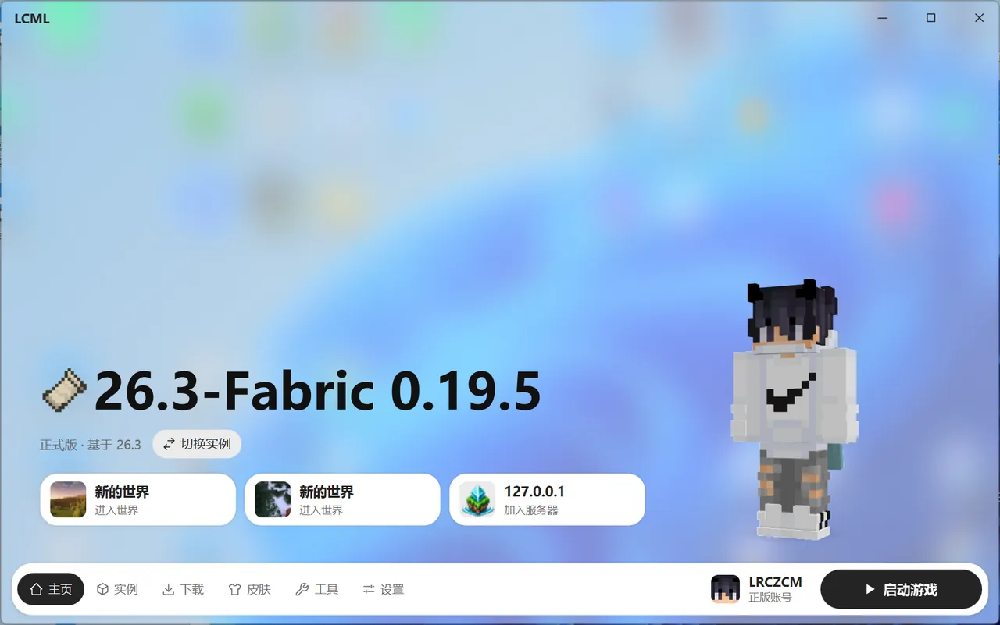

# 主页

主页用来快速进游戏。

## 选实例

点“切换实例”打开实例列表，可以搜索名字，“最近游玩”的实例排在最前面。点“管理实例”会跳到实例页。

## 启动和结束游戏

点右下角的“启动游戏”：

- **准备中**：按钮上显示进度，这时再点一下可以取消。
- **运行中**：游戏已经打开。再点一下可以结束游戏。结束是强制关闭，没保存的进度会丢，最好先在游戏里保存退出。

同一个实例不能同时开两个，不同的实例可以同时开。

还没添加账号或者没有实例时，按钮会提示你先去添加。

## 固定的存档和服务器

主页最多可以固定 3 个存档或服务器，点一下就能直接进入那个世界或服务器，不用在游戏里再点。

固定方法：在实例页的“存档”或“服务器”标签里，点对应那一行的图钉。

## 玩家形象

主页会显示当前账号的 3D 人物，穿着你的皮肤。不想显示、或者想让它动起来，可以在“设置 → 外观 → 主页”里调整。
