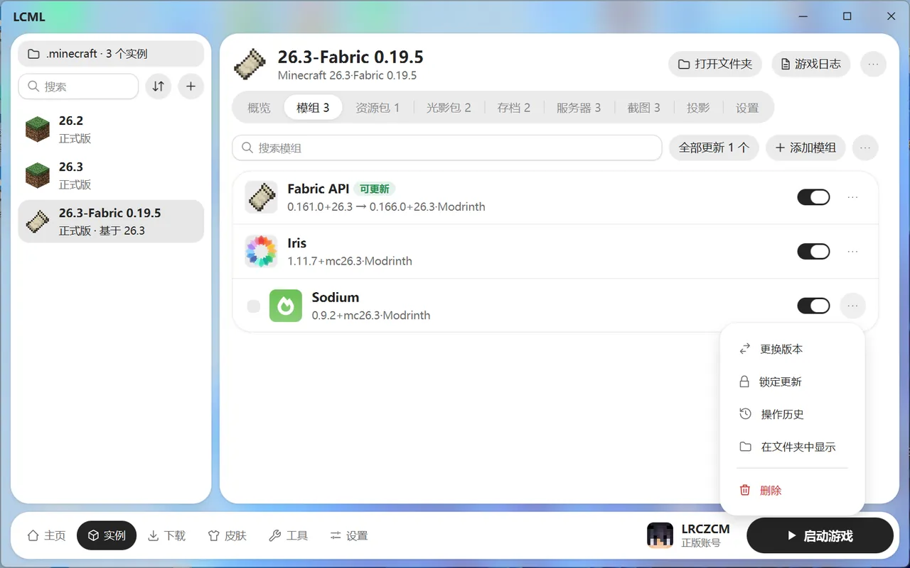
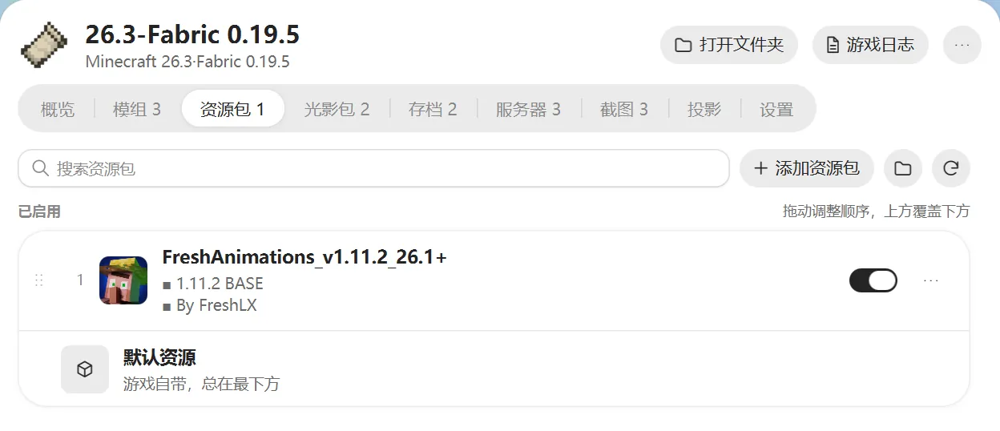
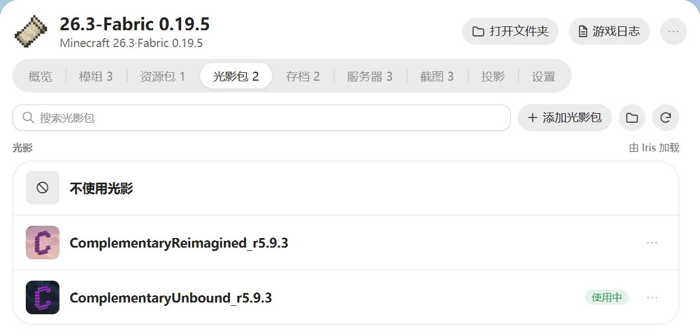

# 模组、资源包与光影

在实例页选中一个实例，下面的标签就是它的内容。游戏运行时，大部分内容不能改，要先关掉游戏。

## 模组

### 添加模组

- 点“添加模组”，选择 `.jar` 文件。
- 把文件直接拖进窗口。
- 在下载页搜索安装，见 [下载模组和其他资源](download-resources.md)。
- 点“打开模组文件夹”，自己把文件放进去。

原版实例不能装模组，要先装加载器（见 [更改加载器](instances.md#更改加载器)）。

### 日常管理

- **启用 / 停用**：点模组右边的开关。停用的模组还在，只是不会加载。
- **搜索**：模组多的时候按名字找。
- **批量操作**：鼠标移到模组上，左边会出现勾选框。勾选多个模组，可以一起启用、停用、更新或删除。
- **删除**：文件移到回收站，删完马上能点“撤销”。

停用或删除一个模组时，如果别的模组需要它，会提醒你，可以选择把相关的模组一起停用。启用模组时缺前置也会提醒。

### 更新模组

打开实例时，启动器会自动检查更新（每天一次）。有新版本的模组会标“可更新”，可以单个更新，也可以点“全部更新”。

想只接受正式版，还是测试版也要，在“设置 → 下载 → 更新通道”里选。

### 单个模组的更多操作

点模组右边的“⋯”按钮：

- **更换版本**：换成别的版本，比如退回旧版。
- **锁定更新**：锁定后，这个模组不再提示更新。选了非最新版本时会自动锁定。
- **操作历史**：看这个模组装过、更新过、删过哪些版本，可以撤销。
- **在文件夹中显示**、**删除**

### 导出模组列表

点“添加模组”旁边的“⋯”，选“导出模组列表”，可以导出成 Markdown 或 CSV 表格，复制或保存为文件，方便发给别人看你装了哪些模组。

## 资源包

列表分两部分：

- **已启用**：拖动可以调整顺序，上面的覆盖下面的。游戏自带的“默认资源”永远在最下面。
- **未启用**：打开开关就会加入已启用。

游戏运行时不能在这里切换资源包，可以在游戏里的资源包界面切换。

## 光影包

光影包需要实例装有 **Iris** 或 **OptiFine** 才能用。没装的话，页面上会提示。

光影一次只能用一个。选一个光影包就会用上，选“不使用光影”就是关掉。

## 数据包

数据包装在存档里，不是装在实例上。在“存档”标签里展开一个存档，点“数据包”旁边的“管理”：

- 可以添加、启用、停用数据包。
- 改动要在下次进入世界，或在游戏里输入 `/reload` 后才生效。
- 停用只是给文件名加上 `.disabled`，文件不会删。

## 截图

在游戏里按 F2 截的图都会在这里显示。

- 点一张图可以放大看，左右切换上一张、下一张。
- 可以复制图片、在文件夹中显示、删除。
- 勾选多张，可以一起复制、删除，或者导出成 ZIP 压缩包。

想看所有实例的截图，去 [工具页](tools.md)。

## 投影

投影是用 Litematica 模组在游戏里显示的建筑蓝图。这里会列出实例里的投影文件，显示尺寸、方块数和作者。

- 点“添加投影”，导入 `.litematic`、`.schem` 等文件。
- 可以复制到其他实例、打开所在文件夹、删除。

要在游戏里用投影，实例需要装 Litematica 模组。没装的话页面上会提示。
