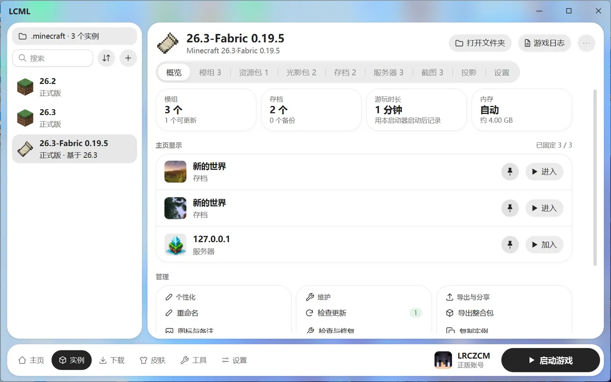
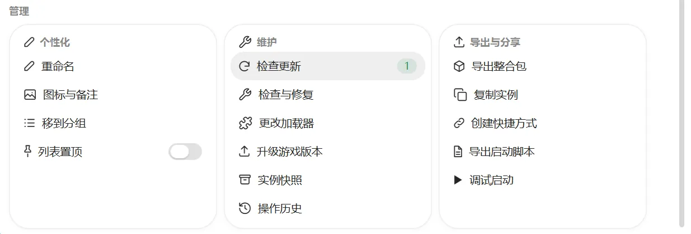
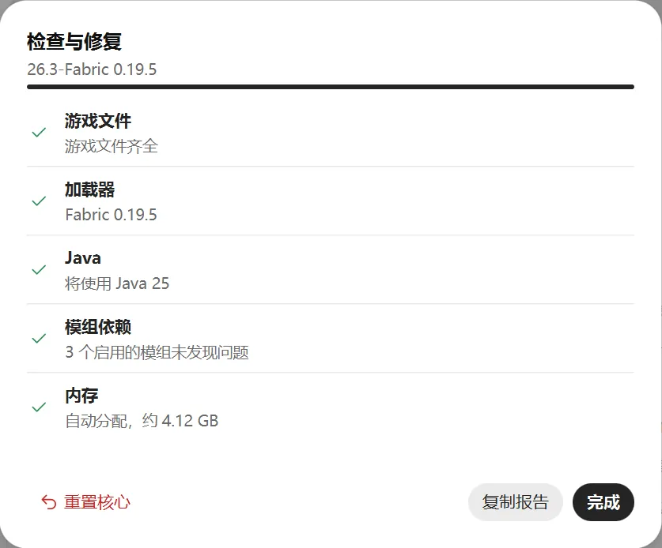

# 管理实例

在底部导航点“实例”。左边是实例列表，右边是选中实例的详情。

## 实例列表

- **游戏目录**：列表最上方显示当前的游戏目录，见下文 [游戏目录](#游戏目录)。
- **搜索**：按名字找实例。
- **排序**：点搜索框旁边的排序按钮，按名称、最近启动或游玩时长排。
- **置顶**：常玩的实例可以放到列表最上面（在“概览”里点“列表置顶”）。
- **分组**：在“概览”里点“移到分组”，可以新建分组或放进已有的分组。在分组标题上点右键，可以重命名或删除分组。删除分组时，里面的实例会回到“未分组”，不会被删。
- **右键实例**：可以快速重命名、复制或删除。
- **新建或导入**：点“+”按钮，可以新建实例、导入整合包、从其他启动器导入。

## 实例详情

右边顶部有三个按钮：

- **打开文件夹**：打开实例所在的文件夹。
- **游戏日志**：查看游戏输出的日志，见 [日志与崩溃](logs-diagnosis.md)。
- **更多**（“⋯”按钮）：重命名、复制实例、删除实例。

下面是各个标签：概览、模组、资源包、光影包、存档、服务器、截图、投影、设置。

## 概览

“概览”一眼能看到：

- 模组数量和可更新的个数。
- 存档数量和备份数量。
- 游玩时长。只统计用 LCML 启动的游戏。
- 内存设置。
- 固定到主页的存档和服务器。

往下滚是这个实例的常用操作，分成“个性化”“维护”“导出与分享”三组，点哪一行就执行哪一项。“检查更新”右边的红色数字是可以更新的个数。

### 个性化

- **重命名**
- **图标与备注**：换一张自己的图片当图标，加一行备注显示在名字下面。
- **移到分组**、**列表置顶**

### 维护

- **检查更新**：检查模组、资源包、光影包和整合包有没有新版本。
- **检查与修复**：游戏打不开时先点它，见下文。
- **更改加载器**
- **升级游戏版本**
- **实例快照**、**操作历史**：见 [快照与操作历史](backup-history.md)。

### 导出与分享

- **导出整合包**：见 [整合包](modpacks.md#导出整合包)。
- **复制实例**：可以选复制哪些内容，比如存档、模组、配置、资源包与光影包、截图。
- **创建快捷方式**：在桌面或开始菜单放一个图标，双击直接启动这个实例。还可以设置成双击直接进入某个存档或服务器。
- **导出启动脚本**、**调试启动**：见 [启动设置](launch-options.md) 和 [日志与崩溃](logs-diagnosis.md)。

## 检查与修复

一键检查实例的常见问题：

- 游戏文件全不全
- 加载器装得对不对
- 用哪个 Java
- 模组缺不缺前置、有没有互相冲突
- 内存设置是否超过电脑内存

有问题的项旁边会有处理按钮，比如“补全文件”。点“复制报告”可以把结果发给别人帮你看。

如果加载器或版本文件坏了，可以点左下角的“重置核心”：按现在的游戏和加载器版本重新安装一遍。模组、配置和存档都不会动。

## 更改加载器

游戏版本不变，可以：

- 给原版装上加载器
- 换成另一种加载器
- 换加载器的版本
- 移除加载器

存档、配置和模组都会保留，不兼容的模组可以选择一键停用。

整合包实例的加载器跟着整合包走，不能单独改。

## 升级游戏版本

比如把实例从 1.20.1 升到 1.21：

1. 选目标版本和加载器版本。
2. 点“检查兼容性”：启动器会逐个检查模组和资源有没有新版本支持。每一项可以选“更新”“保留”或“停用”。
3. 选升级方式：
   - **原地升级**：直接改这个实例，升级前会自动拍快照，出问题可以恢复。
   - **复制为新实例后升级**：原实例不动，在副本上升级。
4. 确认后开始升级。

注意：存档用新版本打开后，再回到旧版本可能会损坏。

## 删除实例

在“更多 → 删除实例”。实例的文件会移到回收站，需要时可以从回收站找回。

正在运行的实例不能删。别的实例还依赖它时，也不能删。

## 游戏目录

游戏目录就是放游戏文件的文件夹（也就是常说的 `.minecraft`）。实例列表最上方显示当前用的游戏目录，点它可以切换，选“管理目录”可以：

- **添加目录**：比如加入其他启动器的 `.minecraft` 文件夹，里面的实例在 LCML 里也能直接启动。
- **切换**：切到另一个目录。切换不会移动任何文件。
- **从列表移除**：只是不再显示，文件不会被删。

## 版本隔离

开启后，每个实例的模组、存档、设置各放在自己的文件夹里，互不影响。新实例默认开启，建议一直开着。

关闭后，这个实例会和其他关闭隔离的实例共用模组和存档，改一个就会影响其他的。在实例的“设置”标签里可以单独开关。
