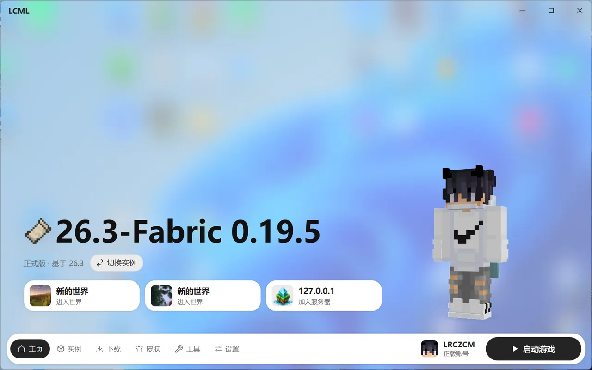

# 界面概览

## 底部导航

窗口底部是导航栏，从左到右是六个页面：

| 页面 | 用来做什么 |
| --- | --- |
| 主页 | 选实例、启动游戏 |
| 实例 | 管理每个实例的模组、存档、设置等 |
| 下载 | 新建实例，下载模组、整合包等资源，查看下载任务 |
| 皮肤 | 换皮肤、换披风 |
| 工具 | 日志分析、清理空间、查看所有截图和投影 |
| 设置 | 启动器的各项设置 |

导航栏右边是**账号按钮**和**启动游戏按钮**，在任何页面都能直接点。

## 标题栏

- 窗口顶部中间有一个“灵动岛”，平时显示正在运行的游戏和下载任务。点开能看到详情，点“在下载页查看全部”可以跳到任务列表。
- 启动器有新版本下载好之后，标题栏会出现“更新”按钮，详见 [设置 · 关于](settings.md#关于)。

## 把文件拖进来

把文件直接拖到窗口的任意位置，松开就能导入。启动器会自己认出是什么文件，放到对应的地方：

- 模组、资源包、光影包、投影：放进当前选中的实例。
- 世界压缩包：导入成实例里的一个新存档。
- 数据包：选一个存档放进去。
- 整合包：导入成一个新实例。

拖之前先在实例页选好要放进去的实例。装模组的实例需要先装好加载器。

## 小提示

- 设置页顶部有搜索框，记不清某个设置在哪时，直接搜名字。
- 界面大小、字体、颜色、背景都能改，见 [设置 · 外观](settings.md#外观)。
