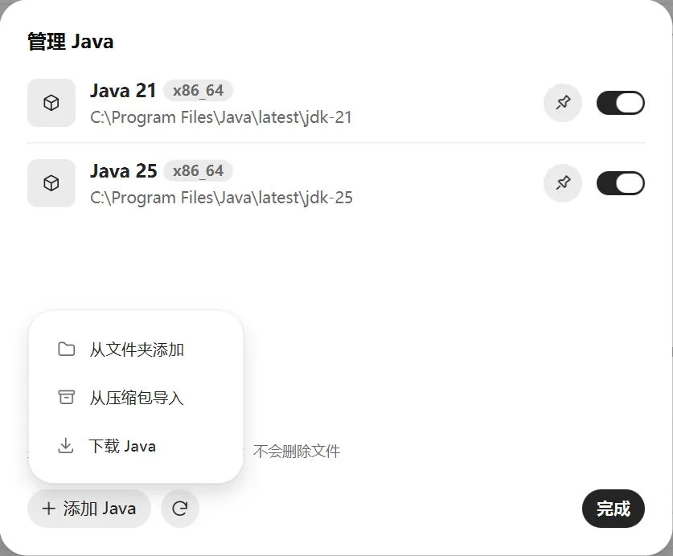

# Java

Minecraft 需要 Java 才能运行，不同游戏版本需要的 Java 版本不一样。**一般不用管**，启动器会自动处理：

- 启动时，自动按游戏版本挑一个合适的 Java。
- 电脑里没有合适的 Java 时，自动下载一个。

## 各版本需要的 Java

| 游戏版本 | Java |
| --- | --- |
| 1.16.5 及更早 | Java 8 |
| 1.17 到 1.20.4 | Java 17 |
| 1.20.5 到 1.21.x | Java 21 |
| 26.1 起 | Java 25 |

## 管理 Java

在“设置 → 游戏 → Java”，点“管理”，能看到启动器找到的所有 Java。启动器会查注册表、常见安装位置，并在各个盘里按名字搜索像 Java 的文件夹。PCL、HMCL 和官方启动器下载的 Java、解压即用的绿色版 Java 也能找到，不用重新下载：

- **开关**：关掉的 Java 不会被自动选择，文件不会删。
- **固定**（图钉按钮）：同一个大版本有好几个时，固定其中一个，以后自动选择时优先用它。
- **添加 Java**：从文件夹添加，或者从压缩包（`.zip`、`.tar.gz`、`.tgz`）导入。
- **重新扫描**（“添加 Java”旁边的刷新按钮）：装了新 Java 之后，点这里重新找一遍。
- **全盘搜索**（在“添加 Java”里）：逐个检查所有硬盘的文件夹，可能要几分钟，进度在“下载 → 任务”里看，可以随时取消。找到的 Java 会一直留在列表里。第一次打开启动器时会在后台自动搜一次，之后装了新 Java 还找不到，再手动点。

## 下载 Java

在 Java 管理里点“添加 Java → 下载 Java”：

1. 选发行商：Temurin、Zulu、Liberica、Corretto 或 Microsoft，都能用。
2. 选版本，对照上面的表格。不确定就选 21。
3. 点“开始下载”。进度在“下载 → 任务”里看。

## 给某个实例指定 Java

在实例的“设置”标签里，把 Java 从“自动”改成某一个。只在自动选择出问题时这样做。

如果指定的 Java 不适合这个游戏版本，启动时会提示你。
