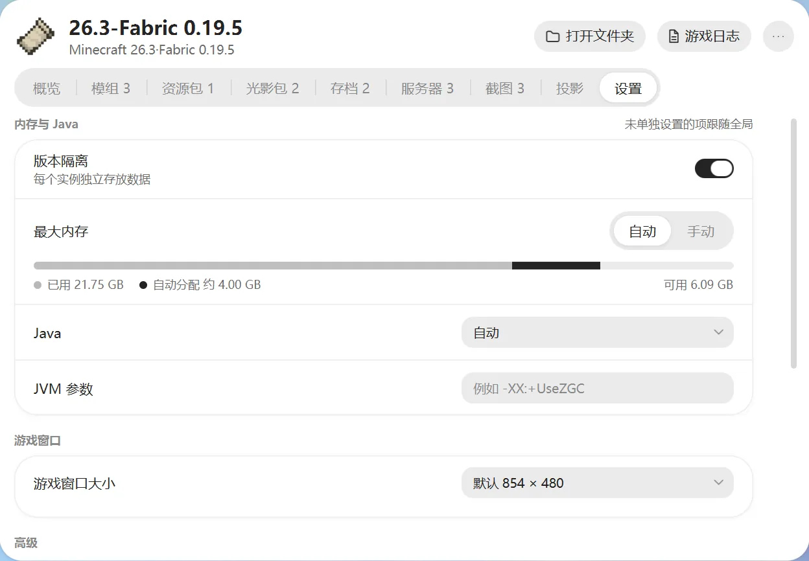

# 启动设置

启动设置有两个地方可以改：

- **全局设置**：在“设置 → 游戏”，对所有实例生效。
- **实例设置**：在实例页的“设置”标签，只对这个实例生效。

实例里没单独改过的项，都跟着全局走。单独改过的项会标“已单独设置”，点“恢复全局”就变回跟着全局。

大多数人不用改这里，默认就能玩。

## 基础

- **游戏目录**：游戏文件放在哪，见 [游戏目录](instances.md#游戏目录)。
- **版本隔离**：每个实例的模组、存档各放各的，建议开着。
- **自动快照**：在更新整合包、升级版本等改动实例的操作之前，自动给实例拍快照，见 [快照与操作历史](backup-history.md)。

## 内存与 Java

- **最大内存**：游戏最多能用多少内存。
  - 选“自动”，启动器会根据电脑内存和实例情况来分配。
  - 选“手动”，自己填一个数。
  - 一般不要超过电脑内存的一半。
- **Java**：默认“自动”，按游戏版本选合适的 Java。需要时也可以手动指定，见 [Java](java.md)。
- **JVM 参数**：给 Java 加的额外参数，用空格分开。不懂可以不填。

## 游戏窗口

游戏窗口的大小：默认、全屏，或自定义宽高。有些很老的游戏版本可能不认这个设置。

## 启动命令

给会折腾的玩家用，普通玩家可以跳过：

- **启动前命令**：启动游戏前先执行一条命令，比如运行一个备份脚本。命令失败的话，游戏不会启动。
- **退出后命令**：游戏关掉后执行。
- **包装器命令**：用别的程序来启动游戏，比如 `prime-run`。
- **环境变量**：给游戏和上面这些命令额外设置一些变量。启动器还会自动带上 `INST_NAME`（实例名）、`INST_DIR`（实例文件夹）、`INST_MC_DIR`（游戏目录）、`INST_JAVA`（Java 路径）。

## 高级

- **优化垃圾回收参数**：默认开启，让游戏运行更流畅。
- **进程优先级**：调高可以减少卡顿，但会占用更多电脑资源。

## 导出启动脚本

在实例的“概览 → 导出启动脚本”，可以导出 `.bat` 或 `.sh` 脚本，不打开启动器也能启动游戏。

脚本里的登录凭据已经打码，用它进不了需要正版验证的服务器。
