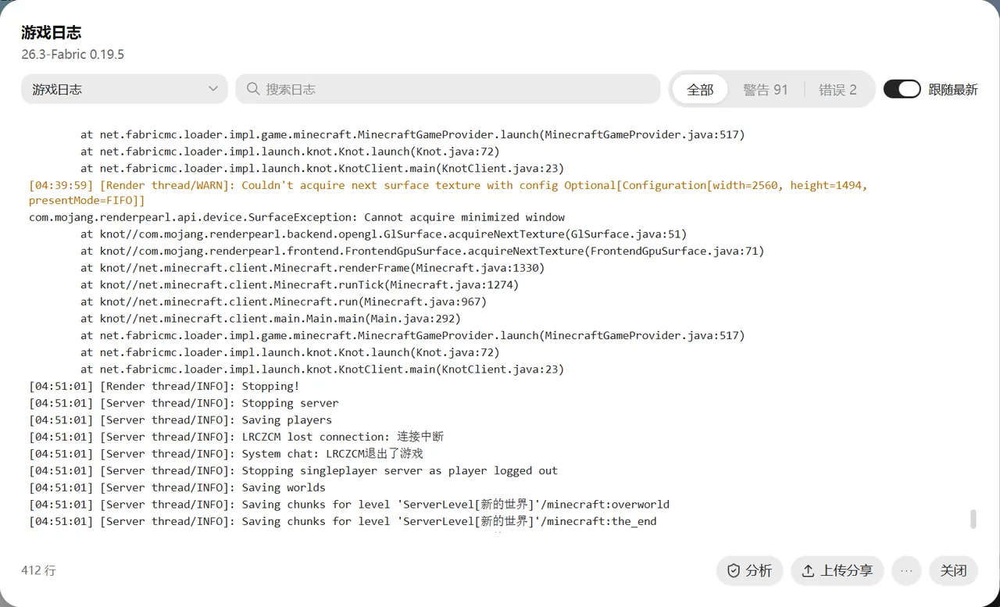

# 日志与崩溃

游戏打不开或者崩溃了，按这个顺序排查：

1. 看崩溃提示里的分析结果，照着建议改。
2. 在实例的“概览 → 检查与修复”里检查一遍，见 [检查与修复](instances.md#检查与修复)。
3. 还是不行，导出诊断包，或者把日志上传分享给别人帮你看。

## 游戏崩溃时

游戏意外退出时，启动器会弹出崩溃提示：

- **分析结果**：自动判断崩溃原因并给出建议。能认出 15 类常见问题，比如缺少前置模组、模组重复、内存不足、Java 版本不对、显卡驱动问题、配置文件损坏等。
- **模组变化**：自上次正常运行以来改了哪些模组，可以直接撤销，见 [快照与操作历史](backup-history.md#崩溃时列出模组变化)。
- **导出诊断包**：把日志、崩溃报告等打成一个压缩包，发给别人帮忙看。
- **重新启动**：改好后直接再启动一次。

## 游戏日志

在实例页右上角点“游戏日志”：

- 游戏运行时，日志实时显示。“跟随最新”打开时会自动滚到最下面。
- 可以搜索关键字，可以只看警告或错误。
- 在“日志来源”里可以切换：本次运行、上次运行、历史游戏日志、崩溃报告、Java 崩溃日志。
- 点“分析”，可以分析当前这份日志的崩溃原因。
- 可以复制全部、导出、上传分享。
- 旧日志可以删除，也可以“清理历史日志”一次清掉。

日志里有很多警告和错误是正常的，大多是模组的普通输出。游戏能正常玩的话，可以不用管。

## 上传分享日志

在游戏日志、崩溃提示或启动器日志里点“上传分享”，日志会上传到网上，并自动复制链接，发给别人就能看。

- 上传到哪里，可以在“工具 → 日志分享”里选 mclo.gs 或 LogShare.cn。国内用 LogShare.cn 更快。
- 上传前会自动隐藏登录令牌和电脑用户名。但日志里可能还有玩家名、服务器地址等信息，上传前确认一下。
- 分享过的日志都记在“工具 → 日志分享”里，可以随时“撤回分享”，网上的日志会被删掉。

## 调试启动

在实例的“概览 → 调试启动”，会以调试模式启动游戏，输出更详细的日志，方便查找难以发现的问题。一般是别人帮你排查时才需要。

游戏卡住不动时，可以在游戏日志里点“导出线程转储”，把游戏卡在哪里记下来，发给懂的人看。

## 启动器自己的日志

启动器出了问题，在“设置 → 关于 → 启动器日志”里查看，反馈问题时附上它。
