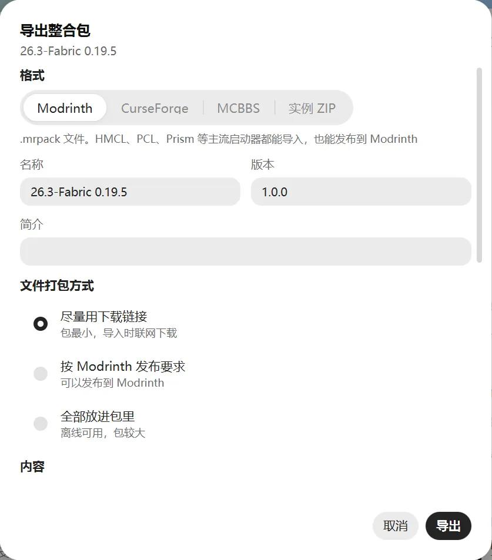

# 整合包

整合包是别人配好的一整套模组和设置。导入后会变成一个新实例，直接就能玩。

## 导入整合包

有三种方法：

- **在线下载**：在“下载 → 资源 → 整合包”里搜索，进入详情页，点“下载并导入”。
- **导入文件**：在实例页点“新建或导入 → 导入整合包”，选择整合包文件。也可以把文件直接拖进启动器窗口。
- **从其他启动器导入**：在实例页点“新建或导入 → 从其他启动器导入”，选择 MultiMC 或 Prism 的实例文件夹。

支持的格式：

- Modrinth 整合包（`.mrpack`）
- CurseForge 整合包（`.zip`）
- MCBBS 整合包（`.zip`）
- MultiMC / Prism 实例
- 打包好的 `.minecraft` 游戏文件夹（`.zip`、`.7z`）

暂不支持 `.rar` 压缩包，先解压再导入。用 Quilt 加载器的整合包也暂不支持。

### 可选文件

有的整合包带“可选文件”，比如额外的光影或小功能模组。导入时会列出来，想要哪些就勾哪些。

### 有文件下载不下来

有些模组作者不允许第三方启动器下载，有些文件已经下架了。遇到这种情况，会弹出“补全缺少的文件”：

1. 点“下载页”，在浏览器里把文件下载下来。
2. 启动器会在你的下载文件夹里自动找到它，放到该放的地方。也可以把文件拖进这个窗口，或点“选择文件”手动选。
3. 都补好后点“继续安装”。已经下架的文件只能跳过。

## 更新整合包

从 Modrinth 或 CurseForge 下载、导入的整合包，作者出了新版本后可以直接更新。

1. 在实例页的“概览”里点“检查更新”。
2. 在“可用更新”里找到整合包，选择要更新到的版本。
3. 确认后开始更新。

更新时：

- 你自己改过或删掉的文件，保持原样。
- 新版本去掉的文件，会移到回收站。
- 更新前会自动给实例拍快照，更新失败会自动恢复。

如果新版本换了游戏版本，旧存档可能打不开，建议先在“存档”标签里备份。

## 导出整合包

把自己配好的实例分享给朋友：在实例页的“概览”里点“导出整合包”。

**选格式：**

| 格式 | 适合 |
| --- | --- |
| Modrinth | HMCL、PCL、Prism 等主流启动器都能导入，也能发布到 Modrinth |
| CurseForge | CurseForge 应用和主流启动器都能导入 |
| MCBBS | HMCL、PCL 等国内启动器常用 |
| 实例 ZIP | MultiMC、Prism 可以直接导入，所有文件都在包里，导入时不用联网 |

**选打包方式：**

- **尽量用下载链接**：包最小，导入时联网下载模组。
- **按 Modrinth 发布要求**：要把整合包发布到 Modrinth 时选这个。
- **全部放进包里**：包比较大，但离线也能导入，适合发给朋友或自己备份。

**选内容：**勾选要带上的东西，比如模组、配置、资源包、存档。没勾的不会导出。账号、日志和缓存不会导出。

公开发布前注意：有些模组作者不允许二次分发，打包进去前先确认。
