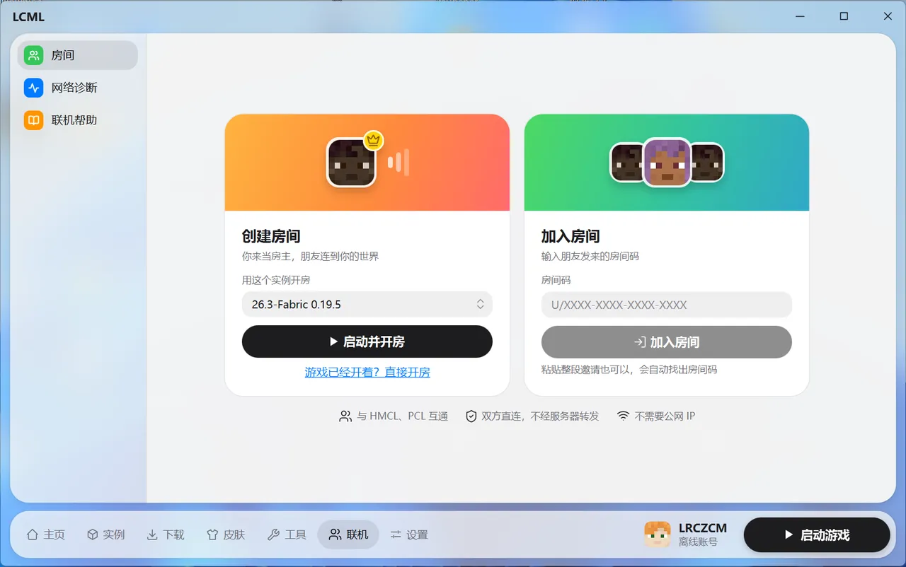
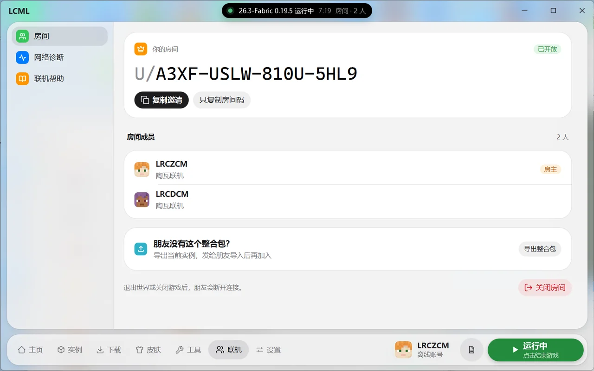
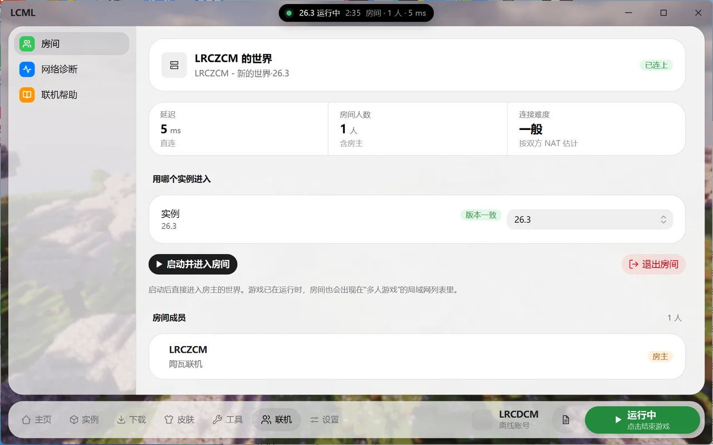

# 联机

和朋友在同一个世界里玩，不需要公网 IP，也不用装虚拟网卡。房间码和 HMCL、PCL 通用：朋友用这两个启动器也能加入你的房间，你也能加入他们的。

在底部导航点“联机”。左边有三项：房间、网络诊断、联机帮助。

## 第一次使用：下载联机组件

联机由开源的“陶瓦联机”提供，约 8 MB，只需下载一次。

- 点“下载联机组件”。下载进度在页面上和标题栏的灵动岛里都能看到，下载完会自动校验、自动启用。
- 下载不下来时，可以自己从陶瓦联机的发布页下载 Windows 版压缩包（文件名形如 `terracotta-0.4.2-windows-x86_64-pkg.tar.gz`，选择文件时的类型栏会写出需要的准确文件名），再点“从文件安装”选中它。文件名改过或版本不对会提示“联机组件文件不对”。
- 目前只支持 Windows。

## 创建房间（当房主）

1. 在“创建房间”卡片里选要用的实例，点“启动并开房”。游戏已经开着的话，点“游戏已经开着？直接开房”。
2. 进入要和朋友一起玩的世界，按 `Esc`，点“对局域网开放”，再点“创建局域网世界”。
3. 启动器检测到后会自动生成房间码。点“复制邀请”，把这段话发到 QQ 或微信群；只想发房间码就点“只复制房间码”。

房间页会列出所有已加入的朋友，以及他们用的启动器。点“关闭房间”结束联机；退出世界或关闭游戏后，朋友也会断开。

注意：

- **用正版账号开房时，离线账号的朋友进不去**（游戏会提示“无效会话”）。想和离线账号的朋友一起玩，请改用离线账号开房。页面上会一直提醒这一点。
- 朋友需要和你用同一个版本。装了模组的话，在房间页点“导出整合包”，把文件发给朋友导入，详见 [整合包](modpacks.md)。

## 加入房间

1. 在“加入房间”卡片里粘贴房间码。整段邀请直接粘贴也可以，会自动找出房间码。打开联机页时剪贴板里已经有房间码的话，会自动填好，旁边显示“已从剪贴板填入”。
2. 点“加入房间”，等待“找到房主”“打通连接”完成。打通时会显示连接难度。
3. 连上后，启动器会读出房主世界的版本和延迟，并自动选好同版本的实例。点“启动并进入房间”，游戏启动后直接进入房主的世界。

已在游戏里的话，房间也会出现在游戏“多人游戏”页的局域网列表里。点“退出房间”结束联机。

在房间里时，灵动岛会显示房间人数和延迟，点开后可以回到联机页。

### 没有同版本的实例

页面会提示“你没有某某版本的实例”：

- 房主玩的是原版或只装了加载器：点“新建实例”，到下载页新建这个版本。
- 房主玩的是整合包：请房主在房间页“导出整合包”发给你，你点“导入整合包”选中收到的文件。导入完成后，在“用哪个实例进入”里选中新实例即可，房间不用重进。

也可以先用其他实例试试，但版本不同通常会被房主的世界拒绝。

### 提示“无效会话”

说明房主用正版账号开房、而你用的是离线账号。启动器发现游戏里出现这个提示后，也会在联机页说明原因。请房主改用离线账号重新开房，或者你也登录正版账号。

## 连不上怎么办

连接失败时页面会写明原因，可以点“重试”或“返回”。陶瓦联机只让双方直接连接，不经服务器转发，所以双方网络都比较严格（常见于校园网和部分移动网络）时可能连不上。可以试试：

- 让网络更宽松的一方开房，通常是家里的宽带。
- 用手机热点给电脑上网再试。
- 在路由器里打开 UPnP 后重试。
- 开着代理软件的话，关掉 TUN 模式再试。
- 确认用的是房主现在的房间码：房主每次开房，房间码都会变。

## 网络诊断

左边点“网络诊断”，打开时会自动检测一次，也可以点“重新检测”。

- **本机 / 房主 NAT 类型**：简单说就是网络“严不严格”，决定能不能直接连通。加入过房间后才能测出来，显示的是最近一次加入的房间。标“较严格”的比较难连通。
- **联机节点**：帮双方找到彼此的公共服务器，不转发游戏数据。列出最近一次联机时，联机组件实际连每个节点的结果：已连上、域名解析失败、证书错误或连不上。还没联机过时这里是空的。全都连不上时，多半是网络或防火墙拦住了。
- **代理提示**：开着代理软件的 TUN 模式（也叫“假 IP”模式）时，联机组件的连接会经过代理，常常找不到对方。启动器检测到时会在这里和连接失败页提示，请关闭 TUN 模式，或在代理规则里让 terracotta 程序直连。
- **联机组件**：显示版本和运行状态。
- **联机日志**：反馈问题时点“分享”，上传后链接会复制到剪贴板。上传前会去掉其中的 IP 地址和用户目录。

## 注意

- 联机组件是独立的程序，关闭启动器时会一起退出。
- 联机帮助页里有简要的玩法说明和常见问题。
