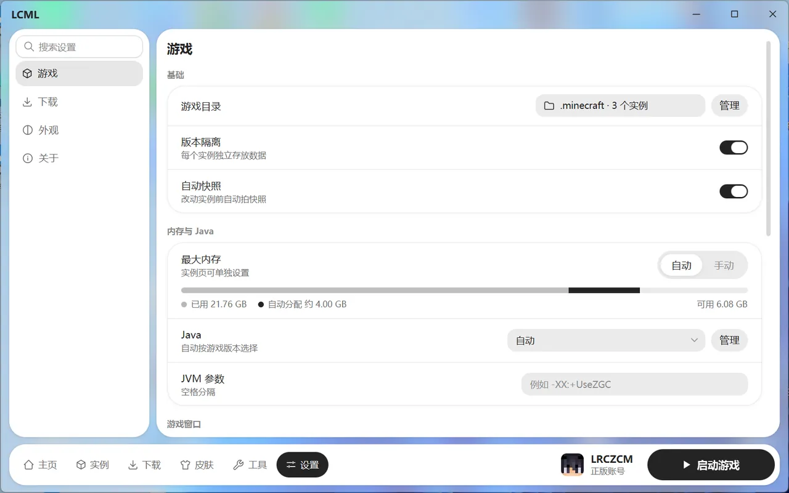
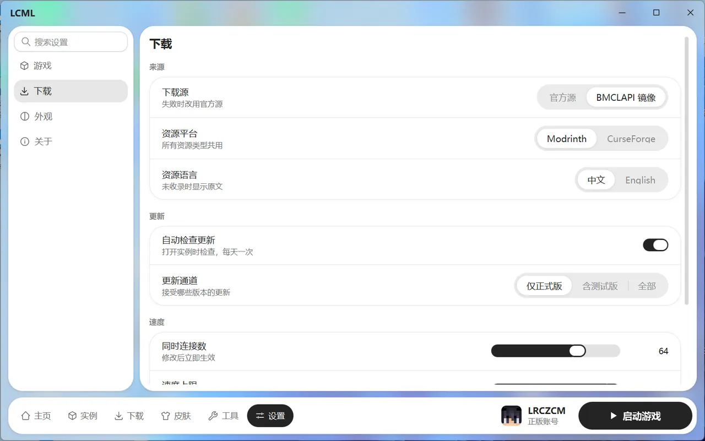
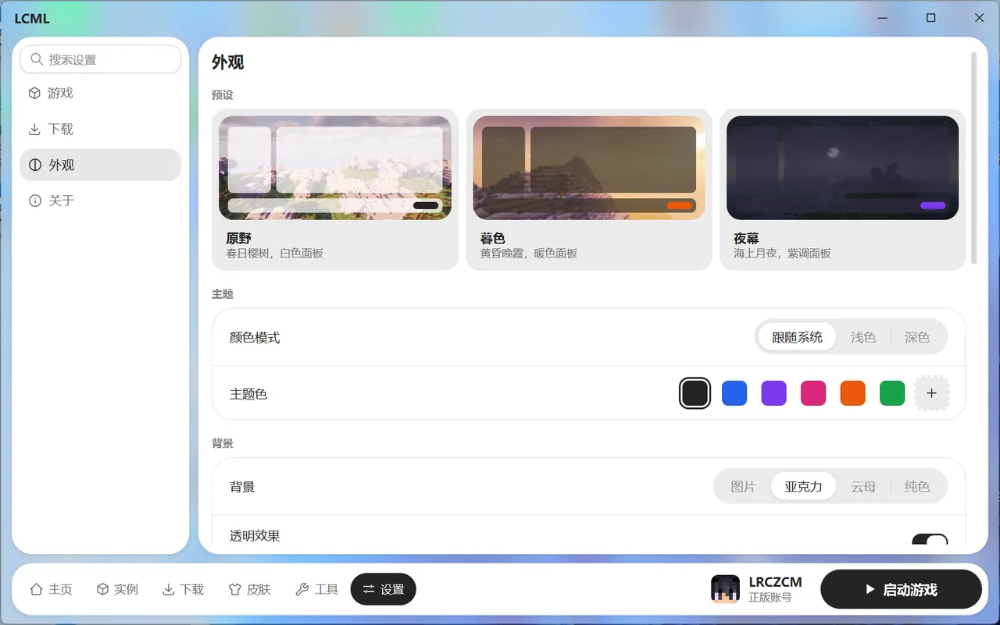
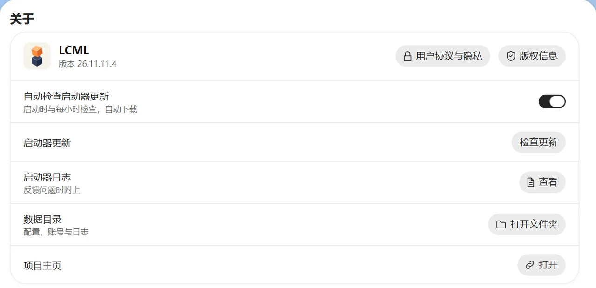

# 设置

在底部导航点“设置”。设置分四页：游戏、下载、外观、关于。顶部有搜索框，输入名字就能找到对应的设置项。

## 游戏

和启动游戏有关的全局设置：游戏目录、版本隔离、内存、Java、游戏窗口、启动命令等。每一项的说明见 [启动设置](launch-options.md)。

## 下载

### 来源

- **下载源**：官方源或 BMCLAPI 镜像，默认用镜像，国内一般更快。一个源失败时，会自动换另一个。
- **资源平台**：搜索模组、整合包等资源时用 Modrinth 还是 CurseForge。
- **资源语言**：资源名称和介绍显示中文还是英文。没有中文翻译的会显示原文。

### 更新

- **自动检查更新**：打开实例时检查模组和资源有没有新版本，每天一次。
- **更新通道**：接受哪些版本的更新，分为“仅正式版”“含测试版”“全部”。求稳选“仅正式版”。

### 速度

- **同时连接数**：同时下载的连接数，改了立即生效。网络不好时可以调低。
- **速度上限**：限制所有下载加起来的速度，免得下载时占满网速，影响别人上网。

### 网络

- **网络代理**：跟随系统、不使用，或手动填 HTTP 代理（地址、端口，需要的话还有用户名和密码）。启动器和游戏都会走这个代理。

## 外观

- **预设**：一键换整套外观，有“原野”“暮色”“夜幕”三种。
- **主题**：
  - 颜色模式：浅色、深色或跟随系统。
  - 主题色：几种预设颜色，也可以自定义。
- **背景**：
  - 亚克力、云母：透明效果，只在 Windows 11 上可用。
  - 纯色：选一种颜色。
  - 图片：用自带的壁纸，或者选自己的图片，还能调模糊和变暗。图片太花、看不清字时，把“变暗”调高一点。
- **面板**：面板的颜色和不透明度。看不清字时调高不透明度。
- **界面**：
  - 界面大小：小、标准、大，立即生效。
  - 界面字体。
  - 界面语言：重启启动器后生效。
  - 动画速度：快速、正常、优雅，或关闭。
- **主页**：是否显示玩家形象和固定项；人物一直动、鼠标放上去才动，还是保持不动。

## 关于

- **版本**：当前的启动器版本。
- **版权信息**、**用户协议与隐私**：查看版权声明和协议全文。
- **启动器日志**：反馈问题时附上。
- **数据目录**：启动器的配置、账号和日志放在哪里，点一下就能打开。
- **自动检查启动器更新**：默认开启。启动时和之后每小时检查一次，有新版本会自动下载。

### 更新启动器

新版本下载好后，标题栏会出现“更新”按钮。点开可以看这次更新了什么：

- **立即重启**：马上换成新版本。游戏正在运行，或者还有任务没完成时，要先等它们结束。
- **稍后**：下次打开启动器时，就是新版本了。

也可以在“关于”里手动点“检查更新”。
