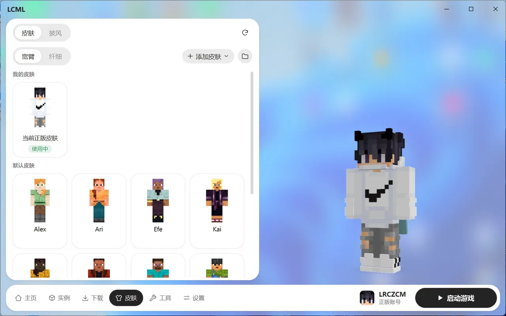

# 皮肤与披风

在底部导航点“皮肤”。左边是皮肤列表，分“皮肤”和“披风”两个标签；右边是你的人物预览。

## 换皮肤

1. 在“皮肤”标签里点一个皮肤，右边会先预览效果。
2. 在上方选模型：“宽臂”（Steve 那种）或“纤细”（Alex 那种）。
3. 点“应用到账号”。

账号正在用的皮肤，卡片上标着“使用中”；正在佩戴的披风标着“佩戴中”。离线账号点一下皮肤或披风就直接换上，不用点“应用到账号”。

### 添加皮肤

点“添加皮肤”：

- **从文件**：选择电脑里的 PNG 皮肤，尺寸要是 64×64 或 64×32。也可以把皮肤图片直接拖进来。
- **从正版玩家名**：输入一个正版玩家的名字，导入他现在用的皮肤。

添加的皮肤保存在“我的皮肤”里。每个皮肤的“更多”菜单里可以重命名、导出 PNG、删除。

“默认皮肤”里是游戏自带的皮肤。下载过任意 1.19.3 或更新的版本后才会显示。

## 换披风

在“披风”标签里选一个披风，点“佩戴”。选“不佩戴”就是去掉披风。点“预览鞘翅”可以看到披风印在鞘翅上的样子。

- 正版账号：显示账号已经拥有的披风。
- 离线账号：可以点“添加披风”，导入自己的披风图片（宽高比 2:1 的 PNG）。

## 不同账号的区别

| 账号 | 换皮肤 | 别人能看到吗 |
| --- | --- | --- |
| 正版 | 在这里换，会同步到你的正版账号 | 能 |
| 离线 | 在这里换 | 只有你自己能看到，多人服务器上别人看到的是默认皮肤 |
| 第三方（皮肤站） | 去皮肤站网页上换，换完点右上角刷新 | 能（在支持这个皮肤站的服务器上） |
