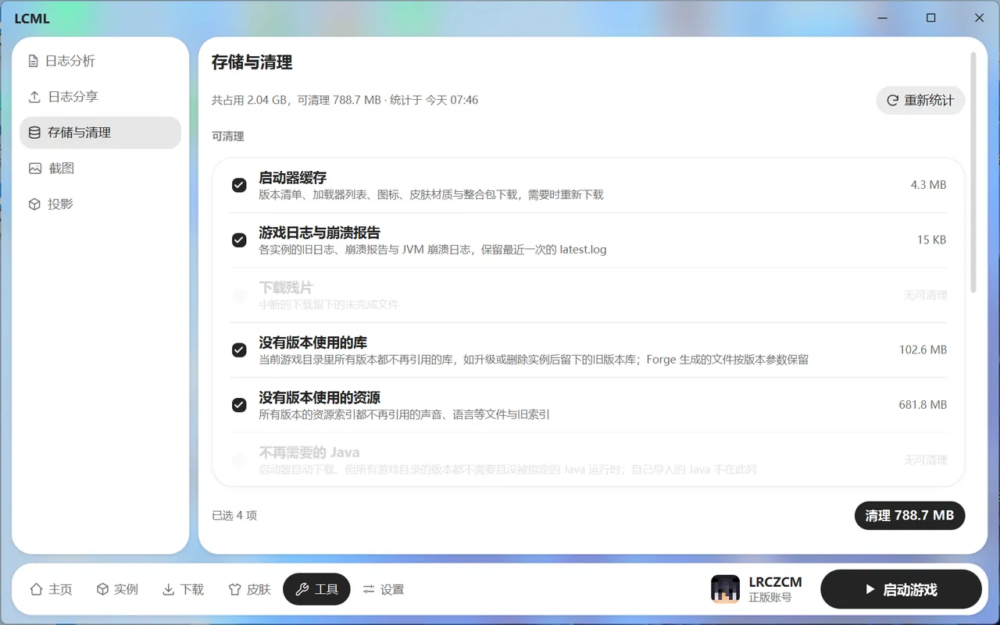

# 工具页

在底部导航点“工具”。

## 日志分析

把日志文件拖进来，或点“选择文件”，就能分析崩溃原因。

- 支持崩溃报告、游戏日志和 Java 崩溃日志（`.log`、`.txt`、`.log.gz`）。
- 只在你的电脑上分析，不会上传。
- 别人发给你的日志也能拿来分析。

## 日志分享

- 选择日志上传到哪里：mclo.gs 或 LogShare.cn（国内更快）。
- 列出你分享过的所有日志，可以复制链接、在浏览器打开、撤回分享。

## 存储与清理

看游戏文件都占了多少空间，并清理不需要的文件。

可以清理的东西：

- **启动器缓存**：版本列表、图标、皮肤等，需要时会重新下载。
- **游戏日志与崩溃报告**：各实例的旧日志，会保留最近一次的。
- **下载残片**：中断的下载留下的半截文件。
- **没有版本使用的库和资源**：升级或删除实例后留下的旧文件。
- **不再需要的 Java**：启动器自动下载、现在没有游戏在用的 Java。你自己导入的 Java 不会被清理。

勾选要清理的项，点“清理”。清理是直接删除，不进回收站。

存档、模组和备份不在这里清理，要到对应的实例里管理。清理前需要先关掉游戏，并等下载任务结束。

## 截图

所有实例的截图都在这里，可以按日期或按实例分组，也能按文件名或实例名搜索。

- 点一张图可以放大看。
- 勾选多张，可以一起复制、删除或导出成 ZIP。
- 点“转到实例”跳到截图所属的实例。

## 投影

所有实例的投影文件都在这里，可以搜索，也能复制到其他实例，或打开所属实例。
