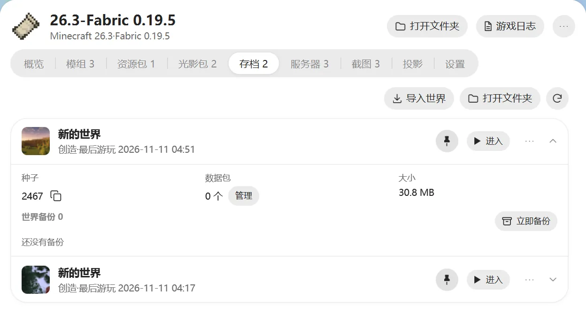
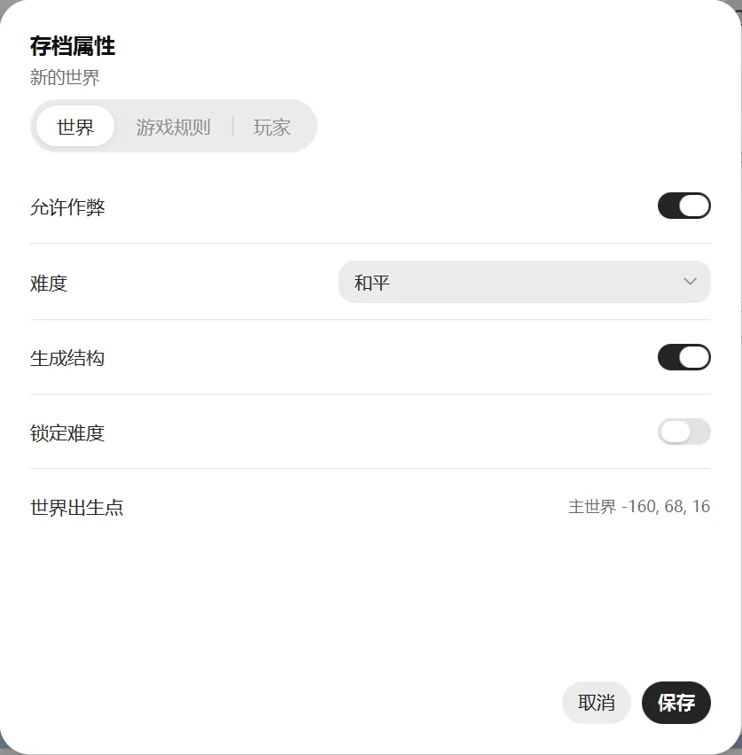
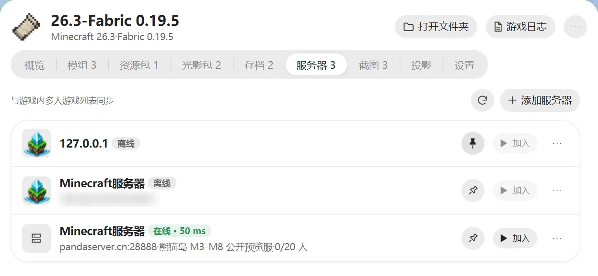

# 存档与服务器

## 存档

实例页的“存档”标签会列出这个实例的所有世界，显示游戏模式和最后游玩时间。点右边的箭头展开，还能看到种子、数据包、大小和备份。

### 一键进入世界

点存档上的“进入”，游戏启动后会直接进入这个世界，不用在游戏里再点。这个功能需要 1.20 及以上版本。

点图钉可以把存档固定到主页，下次在主页一点就能进。

### 备份和恢复

- 点“立即备份”，把这个世界打包存一份。
- 在备份列表里点“恢复”，世界就回到备份时的样子。
- 不要的备份可以删掉。

做大改动之前，比如装新模组、升级游戏版本，建议先备份一下。

### 导入和导出

- **导入世界**：选一个世界的 `.zip` 压缩包，导入成新存档。也可以直接拖进窗口。
- **导出 ZIP**：在存档的“⋯”菜单里，把世界打包成压缩包，方便发给别人。

### 其他操作

在存档右边的“⋯”菜单里：

- **重命名**、**复制**
- **删除**：移到回收站，需要时可以找回。
- **复制种子**
- **数据包**：管理这个存档的数据包。

列表上方的“打开文件夹”可以打开存档所在的文件夹。

### 存档属性

在“⋯”菜单里点“属性”，不进游戏就能改世界的设置：

- **世界**：难度、是否允许作弊、是否生成结构、出生点。
- **游戏规则**：死亡不掉落、昼夜更替、天气变化、生物破坏方块等。
- **玩家**：游戏模式、生命值、饥饿值、经验等级，以及当前位置和上次死亡位置。

改完点“保存”。世界正在游戏里打开时，只能看，不能改。

## 服务器

“服务器”标签里的列表和游戏内的“多人游戏”列表是同一份，在这里改，游戏里也会跟着变。

- **添加服务器**：填名称和地址，比如 `mc.example.com` 或 `1.2.3.4:25565`。
- **查看状态**：显示服务器在不在线、延迟和在线人数。点“刷新状态”可以重新查询。
- **加入**：启动游戏后直接连进这个服务器。
- **编辑**、**复制地址**、**删除**：在服务器右边的“⋯”菜单里。

点图钉可以把服务器固定到主页。

游戏运行时不能修改服务器列表。
